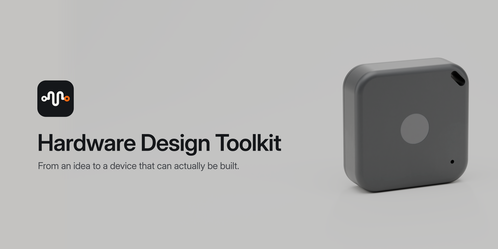
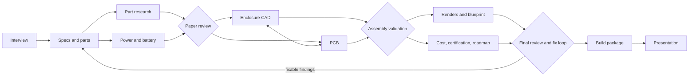
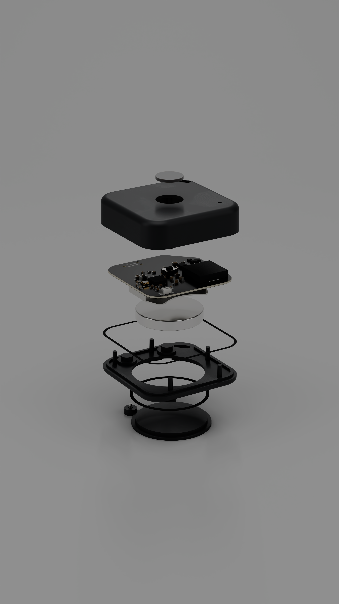

<p align="center">
  
</p>

<p align="center">
  <a href="#install">Install</a> ·
  <a href="#how-it-works">How it works</a> ·
  <a href="#the-skills">Skills</a> ·
  <a href="examples/pocket-beacon">Example</a> ·
  <a href="CONVENTIONS.md">Conventions</a>
</p>

---

The Hardware Design Toolkit is a set of [Claude Code](https://code.claude.com) skills. They take an idea
for an electronic device to a design that a factory can build. You describe what you want. Claude
interviews you, picks real parts and checks that they can be bought. It sizes a battery that exists, lays
out the board in KiCad and models the enclosure in CAD. It validates that nothing collides, renders the
product, draws the blueprint and prices it from 1 to 10,000 units. It lists the certifications and plans
the prototypes. Then it attacks its own design until nothing fixable is left.

The output is a **READY TO BUILD** package:

- a routed board with fab files;
- a BOM that is in stock;
- enclosure STEP files;
- an assembly guide and a test plan;
- an `ORDER.md` that says what to upload where;
- a presentation that explains the product.

## Why

A beautiful render of a device is easy. It is harder to make a device that is real. In practice the
problems look like this:

- The battery in the render has twice the capacity that a real cell of that size can hold.
- The chip is "Active" at the distributor but still sampling at the manufacturer.
- The LED driver needs 2.5 V and sits on a 1.8 V rail.
- The microphone is bottom-port and the design has no hole.
- The board was never routed.

Every rule in this toolkit comes from a mistake like these, made and corrected while a real wearable was
designed. Each skill checks for those mistakes with a script, not with good intentions.

## Quick Start

1. Install the plugin in Claude Code (or clone the repository for any agent runtime):
   ```text
   /plugin marketplace add ctresb/hardware-design-toolkit
   /plugin install hardware-design@hardware-design-toolkit
   ```
2. Launch a hardware project in an empty folder:
   ```text
   /hardware-design:hardware-engineer I want to build a small Bluetooth tag that beeps when I lose my keys
   ```
3. Verify the reference example (`examples/pocket-beacon`) from the terminal:
   ```sh
   python3 skills/doability-review/scripts/doability_score.py --hw examples/pocket-beacon/hw
   python3 skills/build-package/scripts/selftest.py
   ```
   See [docs/hardening-and-dfm-gates.md](docs/hardening-and-dfm-gates.md) for the physics, electrical, RF, and CAD verification gates.

## Install

In Claude Code:

```text
/plugin marketplace add ctresb/hardware-design-toolkit
/plugin install hardware-design@hardware-design-toolkit
```

Then start a project in an empty folder:

```text
/hardware-design:hardware-engineer I want to build a small Bluetooth tag that beeps when I lose my keys
```

The first run checks your machine and offers to install what is missing (`toolchain-setup`). Nothing is
installed without your consent.

<details>
<summary>Manual install (copy the skills)</summary>

```sh
git clone https://github.com/ctresb/hardware-design-toolkit
cp -R hardware-design-toolkit/skills/* ~/.claude/skills/
```

Copy every skill folder. The skills call each other's scripts through relative paths.
</details>

### Software it uses

| Tool | Used for | Required |
|---|---|---|
| [KiCad](https://www.kicad.org) 9 or 10 | schematic, PCB, DRC, fab outputs | yes, for PCB stages |
| [Freerouting](https://github.com/freerouting/freerouting) + Java 21+ | autorouting | for routing |
| [Blender](https://www.blender.org) 5.x | assembly validation, renders, blueprints | yes, for visual stages |
| [build123d](https://github.com/gumyr/build123d) (Python 3.10–3.13) | parametric enclosure CAD, STEP export | yes, for enclosure stages |
| Python 3.10+ | all scripts | yes |
| librsvg (`rsvg-convert`) | SVG to PDF/PNG | yes |
| Chrome or Chromium | presentation layout check and PDF | recommended |
| KiKit, FreeCAD, ffmpeg, ImageMagick | panels, STEP viewing, turntables, photos | optional |
| AWS CLI + Session Manager plugin | cloud GPU rendering | optional |

`toolchain-setup` installs these on macOS (Homebrew), Linux (apt, dnf or Flatpak) and Windows (winget).
It then writes the resolved paths to `toolchain.json` for the other skills.

## How it works

### Architecture



All skills share one workspace in your project, `hw/`. Each file there has exactly one owner skill, and
every number carries its evidence: `verified` with a dated source, `estimate` with its basis, or
`assumption`. The contract is in [CONVENTIONS.md](CONVENTIONS.md).

Gates stop the pipeline when something is wrong:

- an unbuyable part;
- a rail outside a chip's supply range;
- a collision in the assembly;
- an unrouted board;
- a chart label crossing a line.

A finding that the toolkit can fix goes back to the skill that owns it, and the review runs again. Only
items that need you or the physical world stay open, for example a current measurement on the first
prototype. Each one comes with a method and a pass threshold.

## The skills

| Skill | What it does |
|---|---|
| [`hardware-engineer`](skills/hardware-engineer) | Leads the project: stages, gates, parallel work, the fix loop, state |
| [`product-discovery`](skills/product-discovery) | Interviews you about use, environment, size, power, markets and budget, and writes the brief |
| [`specs-engineer`](skills/specs-engineer) | Requirements, architecture, power rails and a part for every function; lints the BOM |
| [`electronics-researcher`](skills/electronics-researcher) | One dossier per part: datasheet facts, max dimensions, lifecycle, prices from 1 to 10k, stock, alternatives |
| [`battery-and-power`](skills/battery-and-power) | Power budget per mode, peak-current chain, and the largest real cell that fits your space |
| [`pcb-engineer`](skills/pcb-engineer) | Generates the KiCad schematic and board from a spec, with legalized placement and keepouts, ERC/DRC, routing and fab outputs |
| [`enclosure-engineer`](skills/enclosure-engineer) | build123d enclosure with DFM checks, STEP export, tolerance stack, sealing; validates the assembly in Blender |
| [`product-render`](skills/product-render) | Photoreal Cycles renders: studio recipes, worn materials, physical solder fillets, cloud GPU guide |
| [`technical-drawing`](skills/technical-drawing) | Vector exploded blueprint with BOM balloons and orthographic views with dimensions |
| [`cost-and-sourcing`](skills/cost-and-sourcing) | Unit cost from 1 to 10k units, one-time costs separated, landed cost per country, suppliers, RFQs |
| [`compliance-planner`](skills/compliance-planner) | Certifications per market (radio, battery, safety, privacy) with cost and lead time |
| [`prototype-roadmap`](skills/prototype-roadmap) | Dev kit to EVT, DVT, PVT and mass production, with the critical path and long-lead orders |
| [`doability-review`](skills/doability-review) | The red team: checks everything again, sends fixes to their owners, and gives the final verdict |
| [`build-package`](skills/build-package) | Assembles the release (fab, assembly, purchasing, mech, test, order steps) and runs the ready-to-build gate |
| [`product-presentation`](skills/product-presentation) | A self-contained HTML deck of the product, with an automated layout check |
| [`lab-notebook`](skills/lab-notebook) | Facts, experiments, lessons and retros, so the project never goes backwards |
| [`toolchain-setup`](skills/toolchain-setup) | Finds, installs and verifies the software |

You can run any skill alone, for example `/hardware-design:doability-review` on a design you already have.

## Example

[`examples/pocket-beacon`](examples/pocket-beacon) is a complete run of the toolkit on a fictional
Bluetooth item finder that runs on a CR2032. It ends **READY TO BUILD (prototype)**:

- a routed 4-layer board with fab files;
- a 32 × 32 × 10 mm enclosure in STEP;
- 47 parts in stock with dated prices;
- a cost model from 10 to 10,000 units;
- a certification plan, a roadmap and a release package with the ordering steps.

<p align="center">
  
</p>

<p align="center">
  
  
  
</p>

The run also improved the toolkit. Each skill bug and missing rule it hit was fixed in the skills
([`docs/integration-report.md`](docs/integration-report.md)).

## Principles

1. **Real before pretty.** Parts are sized by the datasheet's maximum dimensions, never the nominal ones.
   Cells have straight edges and seals. A placeholder never pretends to be the product.
2. **Measure before you commit.** No custom cell, mold or board revision without a measured power budget or
   a dated plan to measure it.
3. **Evidence on every number.** Estimates are labeled, and every estimate comes with the quote or
   measurement that would replace it.
4. **Validate before you show.** No render, drawing or slide comes from an assembly that did not pass the
   validator. No visual leaves without an automated layout check.
5. **Fix, don't report.** The toolkit fixes what it can and asks only about what it cannot.

## Limits

- The toolkit plans certifications. It does not certify anything, and nothing here is legal advice.
- Prices and stock are snapshots with dates. Check them again before you order.
- RF matching, acoustic tuning and the final power numbers need a real prototype and real instruments. The
  toolkit tells you exactly what to measure and the pass values.
- **WARNING** Lithium cells can catch fire when punctured, shorted or charged wrong. Mains-powered designs
  can kill. Follow the safety notes in the skills, and have a qualified person review designs that involve
  either.

## Contributing

Read [CONVENTIONS.md](CONVENTIONS.md) first. A new rule needs the mistake that motivated it. A new script
needs a test that fails without it.

## License

[MIT](LICENSE). This is an independent community project, not affiliated with or endorsed by Anthropic.
"Claude" and "Claude Code" are trademarks of Anthropic.
