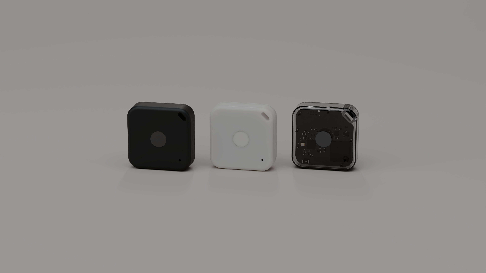
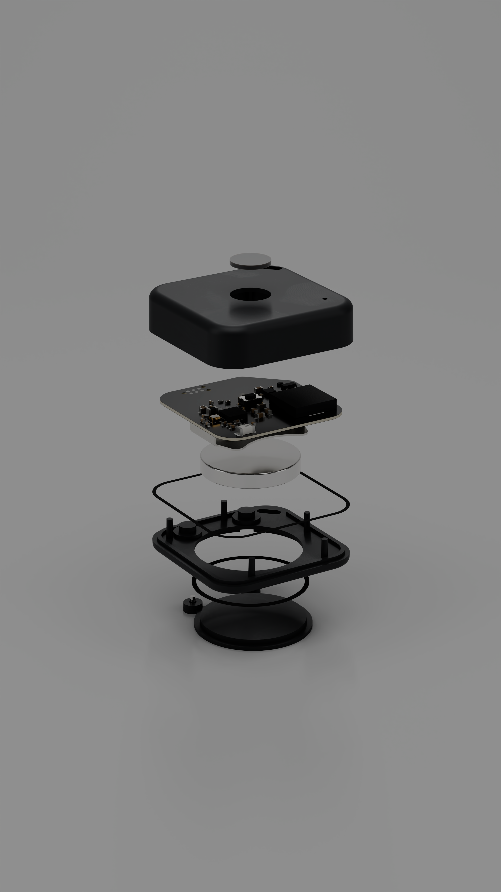
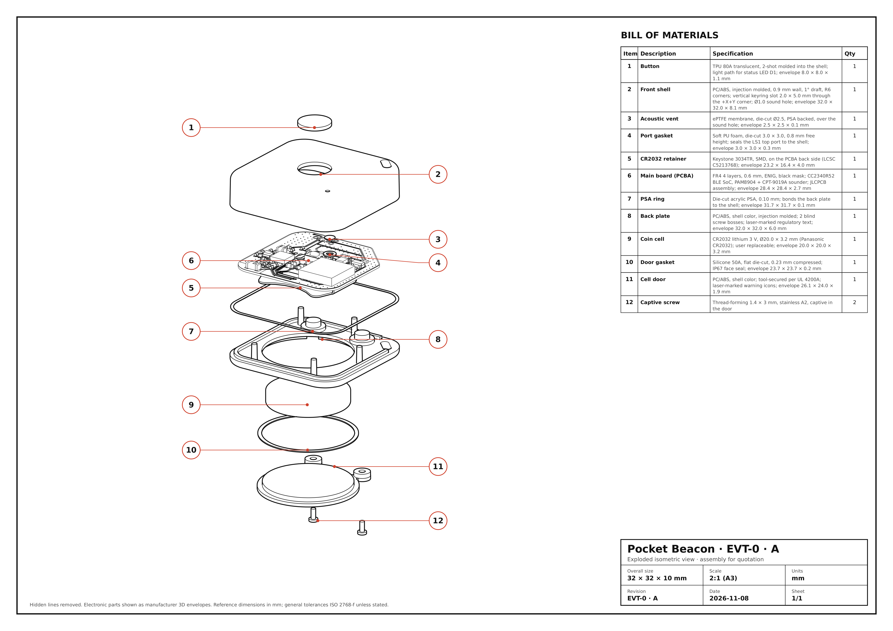

# Pocket Beacon: a complete run of the toolkit

Pocket Beacon is a fictional Bluetooth item finder for keys and bags. It beeps when the phone asks, runs
for more than a year on a CR2032, and is sealed to IP67. Every file in `hw/` was produced by the toolkit's
skills in one session: interview decisions, part research, power, KiCad board, CAD enclosure, validation,
renders, drawings, cost, certification, roadmap, review and release.

**Verdict: READY TO BUILD (prototype).** The board is routed and the fab files pass the release check. The
enclosure is in STEP and the assembly validates. 15 measurements remain for the built prototype, each with
a method and a pass threshold.

| | |
|---|---|
| Size | 32.0 × 32.0 × 10.0 mm, 4.3 g of plastic |
| Radio | TI CC2340R52 BLE SoC, chip antenna |
| Sound | Same Sky CPT-9019A piezo with PAM8904 driver, ≈ 78–80 dB at 25 cm [estimate] |
| Battery | CR2032 in a Keystone 3034TR holder, user-replaceable behind a tool-secured door (UL 4200A) |
| Battery life | 13 months calibrated on real trackers, 35 months bottom-up [estimate] |
| Board | 28.4 mm, 4 layers, 0.6 mm, 47 parts, DRC 0, ERC 0, every part with an LCSC number except the cell |
| Unit cost | US$ 51–153 at 10 units, US$ 8.89–17.1 at 1,000 units (FOB) |
| 10 EVT prototypes | US$ 800–1,800 in total, steps in [`ORDER.md`](hw/release/evt0-a/ORDER.md) |
| Certification | US$ 33k–128.5k for US, EU, UK and Brazil [estimate]; US first |
| First legal US sale | between 2027-05-10 and 2027-09-27 |

## What the toolkit found and fixed

The first parts list looked fine on paper. Research and review changed it:

- **4 of 23 first-choice parts could not be used.**
  - The piezo was last-time-buy.
  - The 48 MHz crystal had 4 units in stock.
  - An RF inductor was obsolete.
  - Two capacitors had no stock.
- **The 22 µF bulk capacitors keep 10.7 µF at 3 V.** A third capacitor was added to meet TI's
  supply-slew limit during the ring.
- **A loud ring on a cold, aged CR2032 browns out the chip.** The firmware rule now picks the ring level
  from the cell voltage under load.
- **Comparison with TI's reference board** found a missing VDDD capacitor and a missing harmonic filter.
- **A coin-cell bayonet did not fit in 10 mm.** The door uses captive screws instead, which still meets
  the US coin-cell law.
- **Assembler catalogs list look-alike parts under genuine part numbers.** Parts are ordered by catalog
  number, and the brand is checked.

## Where to look

| Folder | Content |
|---|---|
| [`hw/brief.md`](hw/brief.md), [`requirements.md`](hw/requirements.md), [`architecture.md`](hw/architecture.md) | What it is and how it works |
| [`hw/bom.csv`](hw/bom.csv), [`hw/parts/`](hw/parts) | The BOM and one dossier per part, with sources and dates |
| [`hw/power/`](hw/power) | Power budget, CR2032 behavior, measurement plan |
| [`hw/pcb/`](hw/pcb) | KiCad project, fab outputs, plots |
| [`hw/mech/`](hw/mech) | build123d CAD, STEP/STL, DFM, tolerances, validated assembly |
| [`hw/renders/`](hw/renders), [`hw/drawings/`](hw/drawings) | Cycles renders and the quotation blueprint |
| [`hw/cost/`](hw/cost), [`hw/compliance.md`](hw/compliance.md), [`hw/roadmap.md`](hw/roadmap.md) | Business |
| [`hw/doability/review.md`](hw/doability/review.md) | The adversarial review and the prototype checks |
| [`hw/release/evt0-a/`](hw/release/evt0-a) | The READY TO BUILD package |
| [`hw/presentation/index.html`](hw/presentation/index.html) | The presentation |
| [`hw/knowledge/`](hw/knowledge), [`hw/decisions.md`](hw/decisions.md), [`hw/retros/`](hw/retros) | How every decision was made |

## What is still open

- **Decisions taken in the product-owner role.** Each one is logged in `hw/decisions.md` for a real
  owner to confirm. Examples: the screw door, and launching in the US first.
- **Quotes.** Final assembly and molding costs decide whether the US$ 12 target at 1,000 units is met
  (`hw/cost/rfq.md`).
- **The 15 prototype measurements:** current, RF match, loudness, sealing and button continuity
  (`hw/doability/review.md`).

Pocket Beacon is fictional. Prices and stock are snapshots from 2026-11-08.
