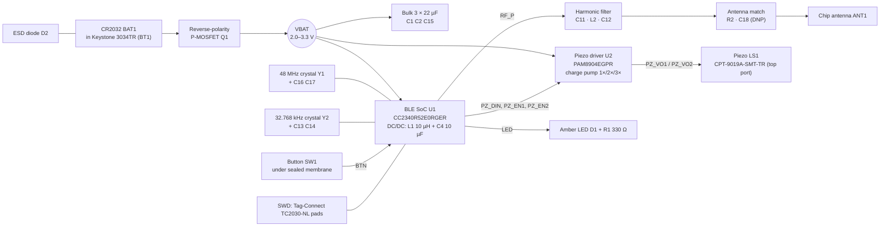

# Architecture: Pocket Beacon

Issue: 2 · Date: 2026-11-08 · Inputs: `hw/brief.md` v1, `hw/requirements.md` issue 2, part dossiers in `hw/parts/`, TI SWRS272F rev F, TI LaunchPad design files SWRC397 · Changes in issue 2: research results (D-018 to D-025), TI reference decoupling and RF filter (D-030, D-031), pin and net map for the PCB (§5)

## 1. Candidate architectures

| Criterion | A: CC2340R5 chip-down (chosen) | B: nRF52 chip-down | C: pre-certified BLE module |
|---|---|---|---|
| Area and height | SoC 4 × 4 × 1.0 mm (VQFN-24) + crystal + 10 µH inductor | 6 × 6 mm QFN48 (nRF52832/52810) or WLCSP (nRF52805, fine-pitch) | module about 10 × 10 to 16 × 10 mm, 2.0–2.2 mm tall |
| Power | TX 5.1 mA at 0 dBm, RX 5.3 mA, standby 0.71 µA **[verified: TI SWRS272F §7.10]** | similar class with DC/DC; not re-verified here | same as its SoC plus module leakage |
| Supply | 1.71–3.8 V direct from the cell **[verified]** | 1.7–3.6 V direct from the cell **[assumption]** | per module |
| Cost at 1k | about USD 0.80–1.33 (LCSC listings, 2026-11-08) **[verified]** | about USD 1.5–3 **[assumption]** | about USD 3–6 **[assumption]** |
| Lifecycle | Active / Production **[verified: TI package addendum]** | mature | depends on vendor |
| SDK | TI SimpleLink Low Power F3 SDK (FreeRTOS, BLE 5.3 stack) | nRF Connect SDK (Zephyr) or nRF5 SDK | vendor SDK of the SoC |
| Risk | RF layout and matching are our job; smaller community than Nordic | same RF work; larger part | taller; antenna placement fixed by the module |
| Certification | full radio certification per market (no modular grant) | same | modular grants reduce radio tests (still needs unintentional-emitter tests and labeling) |

**Recommendation: A.** It has the lowest peak current per dBm of the three, runs from the cell with no regulator, is the cheapest at 1k, and is in JLCPCB/LCSC stock. Its main cost is the full radio certification that chip-down needs. `compliance-planner` should compare that cost against option C (D-012).

## 2. Block diagram

## 3. Rails

| Rail | Source | Nominal | Range | Average load | Peak load | Parts on the rail |
|---|---|---|---|---|---|---|
| VBAT_RAW | CR2032 + terminal of BT1 | 3.0 V | 0 V (cell reversed) to 3.3 V | — | — | BT1 (+), D2, Q1 drain |
| VBAT | VBAT_RAW through Q1 (≤ 3 mV drop at 15 mA, F-205) | 3.0 V | 2.0 V (end of life, under load) to 3.3 V (fresh, open circuit) [verified: F-203, F-402] | 7.2 µA baseline, 19.3 µA empirical (power/power.md) | 15.05 mA (3× ring, healthy cell only, D-028); 5.1 mA TX bursts fed by the bulk capacitors | U1 VDDS (pins 11, 18, 24), U2 VDD, R1/D1, R3, C1–C3, C5, C6, C7, C15, C21 |
| VDDR | U1 internal DC/DC: DCDC pin 17 → L1 → VDDR pins 2, 20 | internal ≈ 1.4–1.5 V [assumption: not stated in SWRS272F] | — | — | — | C4 10 µF, C22, C23 only. No external load (SWRS272F Table 6-10 note 1) |
| VDDD | U1 internal 1.28 V regulator, pin 16 | 1.28 V | — | — | — | C19 1 µF only. No external load |
| PZ_VCP | U2 charge-pump output | up to 3 × VBAT | ≤ 13.5 V abs. max (DS41667) | 0 when idle (auto shutdown 42 ms after DIN stops) | — | C8 (16 V rated) |

Rail data for the scripts is in `hw/power/rails.json` (owner `battery-and-power`). VBAT `max_ma` = 15 mA is the planning limit for **continuous** load on a CR2032 at room temperature (F-204). Short TX bursts above it are carried by the bulk capacitance (§4).

## 4. Peak path and firmware rules

| Event | Current at the cell | Duration | What feeds it |
|---|---|---|---|
| BLE TX at 0 dBm, DC/DC on | 5.1 mA [verified: SWRS272F §7.10] | ≈ 0.3 ms per channel, 3 channels per advertising event [estimate: power.md] | C1 + C2 + C15 + C3: ≥ 27 µF effective worst case at 3.0 V (D-022). The cell supplies the average |
| BLE TX at 0 dBm below 2.2 V (GLDO) | 9.0 mA [verified: F-101] | as above | as above |
| Ring, 2× mode (default start) | 6.4 mA + U1 0.85 mA [verified: DS41667; power.md] | 12 s | the cell directly |
| Ring, 3× mode (only if VBAT ≥ 2.7 V under load) | 14.2 mA + U1 0.85 mA = 15.05 mA [verified: DS41667; power.md] | 12 s | the cell directly |
| LED | 3.5 mA at 3.0 V, 0.8 mA at 2.0 V [estimate: D-024] | 100 ms flashes | the cell |

**Firmware rules** (D-028; the firmware owner implements them, and the EVT power profile verifies them, V-002 and V-003):

1. Every ring starts in 2× mode (PZ_EN1 = 0, PZ_EN2 = 1).
2. 100 ms after the ring starts, read VBAT with the internal battery monitor while the driver runs.
3. If VBAT ≥ 2.7 V, switch to 3× (PZ_EN1 = 1, PZ_EN2 = 1).
4. If VBAT < 2.3 V, switch to 1× (PZ_EN1 = 1, PZ_EN2 = 0) and report a low battery to the app.
5. While the ring runs in 3×, keep the LED off and TX power at 0 dBm or lower.
6. Never transmit above 0 dBm in this product.

`bom_check.py` warns that the sum of single-part peaks (27 mA: U1 TX at +8 dBm, the 3× ring, the LED) exceeds 15 mA. Rules 5 and 6 prevent that sum. TX bursts during a ring last 0.3 ms and are fed by the bulk capacitance. The worst coincident load is 15.05 mA + 5.1 mA for 0.3 ms. The VDDS slew at that load stays within 1 mV/µs with ≥ 14.2 µF effective (F-303, D-022). The warning is accepted with this reason.

## 5. Pins and nets (input for `pcb-engineer`)

### 5.1 U1 CC2340R52E0RGER, VQFN-24 (RGE)

Pin numbers and functions are from SWRS272F rev F Figure 6-2 and Table 6-1 [verified: datasheet read 2026-11-08]. High-drive pins in the RGE package: DIO12, DIO16, DIO17 and DIO24.

| Pin | Pin name | Net | Function | Notes |
|---|---|---|---|---|
| 1 | ANT | RF_P | RF to the harmonic filter | 50 Ω coplanar line, shortest path to C11 |
| 2 | VDDR | VDDR | internal supply | C22 100 nF at the pin |
| 3 | DIO8 | PZ_EN1 | U2 EN1 (mode) | |
| 4 | DIO11 | PZ_EN2 | U2 EN2 (mode) | |
| 5 | DIO12 | (spare, not connected) | spare, high drive; no test pad on EVT-0 (D-518) | |
| 6 | DIO13 | UART_TX | factory test log (UART0TXD, mux 3) | test pad TP5 |
| 7 | DIO16_SWDIO | SWDIO | debug | TC2030 pad 2 |
| 8 | DIO17_SWDCK | SWDCK | debug | TC2030 pad 4 |
| 9 | DIO20_A11 | PZ_DIN | 4 kHz square wave to U2 DIN (LGPT1 channel 0, T1C0, mux 4) | test pad TP4 |
| 10 | DIO21_A10 | BTN | SW1 to GND, internal pull-up, wake from standby | test pad TP6. All digital I/Os are interrupt and wake-up capable [verified: SWRS272F §8, "All digital I/Os are interrupt and wake-up capable"] |
| 11 | VDDS | VBAT | supply | C21 100 nF at the pin |
| 12 | DIO24_A7 | LED | D1 anode through R1, active high (D-518) | high-drive pin |
| 13 | RSTN | nRESET | reset, active low | R3 100 kΩ to VBAT, C20 100 nF to GND (TI LaunchPad), TC2030 pad 3 |
| 14 | DIO3_X32P | X32P | 32.768 kHz crystal Y2 | C13 12 pF to GND |
| 15 | DIO4_X32N | X32N | 32.768 kHz crystal Y2 | C14 12 pF to GND |
| 16 | VDDD | VDDD | internal 1.28 V regulator | C19 1 µF at the pin, no other load |
| 17 | DCDC | DCDC | DC/DC switch node | L1 to VDDR; L1 and C4 next to pin 17 (TI LaunchPad note "place L1 and C105 close to pin 30" on RKP) |
| 18 | VDDS | VBAT | supply | C5 100 nF at the pin, C3 10 µF nearby |
| 19 | DIO6_A1 | SPARE2 | spare, analog capable | test pad TP8 (reserved for a future network function, D-003) |
| 20 | VDDR | VDDR | internal supply | C4 10 µF + C23 100 nF |
| 21 | X48P | X48P | 48 MHz crystal Y1 | C16 9 pF to GND |
| 22 | X48N | X48N | 48 MHz crystal Y1 | C17 9 pF to GND |
| 23 | GND | GND | ground | |
| 24 | VDDS | VBAT | supply | C6 100 nF at the pin |
| EP | GND | GND | exposed pad | via array to the inner ground plane |

GPIO use: 10 of 12 (two crystal pins, two SWD pins, six functions). Spare: SPARE1 and SPARE2. The gate needs ≥ 2.

### 5.2 Net list

| Net | Connects |
|---|---|
| VBAT_RAW | BT1 + terminal, D2 pin 1, Q1 drain |
| VBAT | Q1 source; U1 pins 11, 18, 24; U2 VDD; R3; C1, C2, C15, C3, C5, C6, C21, C7; TC2030 pad 1; TP1 |
| GND | BT1 − pad, D2 pin 2, Q1 gate, U1 pin 23 + EP, U2 GND, all capacitor returns, SW1, D1 cathode, ANT1 ground clearance boundary, TC2030 pad 5, TP2 |
| VDDR | U1 pins 2, 20; L1 output; C4, C22, C23 |
| DCDC | U1 pin 17; L1 input |
| VDDD | U1 pin 16; C19 |
| nRESET | U1 pin 13; R3; C20; TC2030 pad 3 |
| SWDIO, SWDCK | U1 pins 7, 8; TC2030 pads 2, 4 |
| X48P, X48N | U1 pins 21, 22; Y1 pins 1, 3 (Y1 pins 2, 4 to GND per the ABM11W pinout); C16, C17 |
| X32P, X32N | U1 pins 14, 15; Y2; C13, C14 |
| RF_P | U1 pin 1; C11 (shunt); L2 input |
| RF_F | L2 output; C12 (shunt); R2 input |
| RF_ANT | R2 output; C18 (shunt, DNP footprint); ANT1 pin 1 (feed) |
| ANT_NC | ANT1 pin 2: solder pad only, no copper connection (Johanson datasheet) |
| PZ_DIN, PZ_EN1, PZ_EN2 | U1 pins 9, 3, 4; U2 DIN, EN1, EN2 |
| PZ_VO1, PZ_VO2 | U2 outputs; LS1 terminals |
| PZ_CP1P/PZ_CP1N, PZ_CP2P/PZ_CP2N | U2 flying-capacitor pins; C9, C10 |
| PZ_VCP | U2 charge-pump output; C8; TP3 |
| LED | U1 pin 5; R1 → LED_A → D1 anode |
| BTN | U1 pin 10; SW1 (other side to GND); TP6 |
| UART_TX | U1 pin 6; TP5 |
| SPARE1, SPARE2 | U1 pins 12, 19; TP7, TP8 |

U2 pin numbers come from the PAM8904E W-QFN2020-12 pin table in DS41667 (`pcb-engineer` reads them from the dossier source). The LED net is U1 pin 5 → R1 → D1 anode, D1 cathode → GND. VBAT does not reach the LED directly.

### 5.3 RF chain (D-020, D-030)

RF_P → C11 1.5 pF shunt → L2 2.7 nH series → C12 1.5 pF shunt → R2 0 Ω series → C18 shunt (DNP) → ANT1.

- C11, L2 and C12 form the harmonic low-pass filter. It has the topology and start values of the TI LaunchPad (C33 1.5 pF, L33 2.8 nH, C34 1.5 pF; F-502).
- R2 and C18, with C12, form the antenna match. Fit R2 as an inductor or a capacitor and populate C18 when VNA tuning on the EVT board calls for it (V-005).
- Every part sits on a 50 Ω grounded coplanar line with a via fence. The line runs at least 1 mm from the holder's metal.

## 6. Stack-up (height), maximum dimensions

| Layer, front to back | Thickness | Evidence |
|---|---|---|
| Front shell wall over the sounder | 1.0 mm | [assumption: enclosure-engineer sets the wall; 1.0 mm PC wall is the planning value] |
| Clearance part to wall | 0.15 mm | [assumption] |
| Tallest front-side part: LS1 CPT-9019A 2.1 mm max (SW1 2.0 mm, L1 1.45 mm, ANT1 1.4 mm) | 2.1 mm | [verified: dossiers] |
| PCB 4-layer 0.8 mm, +10 % fab tolerance | 0.88 mm | [assumption: fab tolerance ±10 %] |
| Back side: BT1 Keystone 3034TR with the cell | 4.1 mm | [verified: F-202] |
| Clearance holder to lid | 0.2 mm | [assumption] |
| Lid at the center | 1.2 mm | [assumption] |
| **Total at the center** | **9.63 mm** worst case | [estimate: sum of maxima; limit 10.0 mm, REQ-001] |

The 8.5 mm target stays a v2 goal: a lid-retained cell with spring contacts saves ≈ 0.9 mm (L-003, D-018).

## 7. Average current

The stage-2 bottom-up estimate (10–12 µA) is superseded by the calibrated budget in `hw/power/power.md`. Its result after the issue-2 parts (re-run 2026-11-08):

| Scenario | Average | Battery life at end of life |
|---|---|---|
| Baseline | 7.2 µA | 35 months |
| Pessimistic (× 2) | 14.3 µA | 17.5 months |
| Empirical (shipped CR2032 trackers) | 19.3 µA | 13.1 months |

The 12-month limit is 21.2 µA (REQ-002). The EVT power profile (V-002) replaces these with a measurement.

## 8. Test and programming

- **SWD:** Tag-Connect TC2030-NL footprint (pads and 3 locating holes, no part in the BOM). Pads: 1 VBAT, 2 SWDIO, 3 nRESET, 4 SWDCK, 5 GND, 6 NC [assumption: Tag-Connect ARM Cortex SWD mapping; check the TC2030-NL drawing]. Front side, outside the antenna clearance.
- **Test pads** (Ø 1.0 mm, back side, outside the holder footprint, reachable by the factory pogo fixture): TP1 VBAT, TP2 GND, TP3 PZ_VCP, TP4 PZ_DIN, TP5 UART_TX, TP6 BTN, TP7 SPARE1, TP8 SPARE2.
- **Current measurement:** the cell is inserted at final assembly. For the EVT power profile (V-002), the bench supply feeds TP1/TP2 with the cell removed.

## 9. Open questions

All stage-2 questions are resolved (see `hw/state.json`). The one that remains blocks the enclosure stage:

- **Q-PB-204 (enclosure-engineer):** the coin-operated bayonet lid and its UL 4200A tests, the button membrane force, and the top-port sound path. See `hw/mech/constraints.md`.
