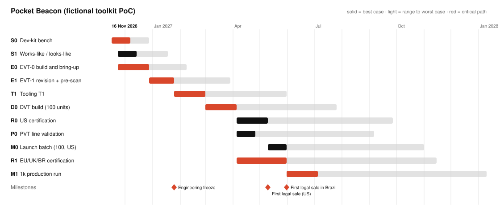

# Roadmap — Pocket Beacon

**Date:** 2026-11-08. **Start:** 2026-11-16. **Stages file:** `hw/roadmap/stages.json`. Durations are `[estimate]` unless a stage says otherwise.

## Answer first

- **Where the project is now:** before Stage 0. The design exists on paper and in CAD (brief, requirements, architecture, a researched BOM, a power budget, and the enclosure/PCB co-design in progress). Nothing has been powered or measured.
- **First legal sale (US):** 2027-05-10 at best, 2027-09-27 at worst. Brazil and the 1k run: 2027-05-31 to 2027-11-15 for the certificates, first 1k lot 2027-07-05 to 2028-01-10. The critical path (worst case) is S0 → EVT-0 → EVT-1 → tooling T1 → DVT → EU/UK/BR certification → 1k run, 33–60 weeks.
- **Order now:** buy EVT + DVT quantities (about 130 each) of U1, Q1, Y2, D2, ANT1 and LS1 from current stock. Their factory lead times (13–40 weeks) are longer than the time to DVT, so stock is the only route (`hw/cost/sourcing.md` "Buy now").
- **The next gate:** Stage 0, measured average current ≤ 20 µA and ring ≥ 75 dB(A) at 25 cm on the TI LaunchPad, owned by firmware + battery-and-power, due 2026-12-07 to 2026-12-28.
- **No custom part waits on a measurement.** The cell is a catalogue CR2032, so the usual "measure → custom cell → UN 38.3" chain does not exist here. The measurement still gates the advertising interval and the ring modes (D-028), and it must pass before tooling T1.

## Timeline

Start 2026-11-16. Durations are `[estimate]` unless a stage says otherwise. Best case uses the short end of every range, worst case the long end.

**Finish:** Jul 2027 (best) to Jan 2028 (worst), 33–60 weeks.

**Critical path (worst case):** S0 → E0 → E1 → T1 → D0 → R1 → M1.

| Stage | Weeks | Start (best → worst) | End (best → worst) | Exit gate | Critical |
|---|---|---|---|---|---|
| **S0** Dev-kit bench | 3–6 | 2026-11-16 → 2026-11-16 | 2026-12-07 → 2026-12-28 | measured average current <= 20 uA with the chosen advertising (1285 ms) and 10 rings/month (power.md M1-M9); ring >= 75 dB(A) at 25 cm in 3x on a fresh cell | yes |
| **S1** Works-like / looks-like | 3–5 | 2026-11-23 → 2026-12-14 | 2026-12-14 → 2027-01-18 | printed enclosure closes on the real stack (10.0 mm limit); bayonet turns >= 90 deg with a coin; IPX7 pre-test in a bucket passes |  |
| **E0** EVT-0 build and bring-up | 5–8 | 2026-11-23 → 2026-12-14 | 2026-12-28 → 2027-02-08 | all rails up, BLE link at 10 m, current within 20 % of the bench, antenna matched in the printed shell | yes |
| **E1** EVT-1 revision + pre-scan | 4–7 | 2026-12-28 → 2027-02-08 | 2027-01-25 → 2027-03-29 | pre-scan passes FCC 15.247 / EN 300 328 margins; ESD +/-8 kV contact on the button and lid; engineering freeze | yes |
| **T1** Tooling T1 | 5–9 | 2027-01-25 → 2027-03-29 | 2027-03-01 → 2027-05-31 | T1 parts within drawing tolerances; bayonet torque and O-ring compression measured; cosmetic spec agreed for three colors | yes |
| **D0** DVT build (100 units) | 5–8 | 2027-03-01 → 2027-05-31 | 2027-04-05 → 2027-07-26 | IP67, 1.5 m drop (26 drops), -10 C ring, button life, UL 4200A pre-check passed; 12-month life confirmed from measured current | yes |
| **R0** US certification | 5–9 | 2027-04-05 → 2027-07-26 | 2027-05-10 → 2027-09-27 | FCC grant, UL 4200A test report, IP67 report, Bluetooth listing |  |
| **P0** PVT line validation | 3–6 | 2027-04-05 → 2027-07-26 | 2027-04-26 → 2027-09-06 | fixtures validated; first-pass yield >= 95 %; packaging with coin-cell warnings approved |  |
| **M0** Launch batch (100, US) | 3–5 | 2027-05-10 → 2027-09-27 | 2027-05-31 → 2027-11-01 | 100 units shipped to US customers |  |
| **R1** EU/UK/BR certification | 8–16 | 2027-04-05 → 2027-07-26 | 2027-05-31 → 2027-11-15 | EU DoC with reports, UK DoC, Anatel certificate | yes |
| **M1** 1k production run | 5–8 | 2027-05-31 → 2027-11-15 | 2027-07-05 → 2028-01-10 | first 1k lot shipped | yes |

## Milestones

| Milestone | After | Date (best → worst) |
|---|---|---|
| Engineering freeze | E1 | 2027-01-25 → 2027-03-29 |
| First legal sale (US) | R0 | 2027-05-10 → 2027-09-27 |
| First legal sale in Brazil | R1 | 2027-05-31 → 2027-11-15 |

## Long-lead purchases

Order date = start of the stage that needs the part (best case) minus the lead time.

| Item | Lead time (weeks) | Needed by | Order by | Status |
|---|---|---|---|---|
| U1 CC2340R52E0RGER (TI 26 wk factory; buy 130 from LCSC/DigiKey stock now) | 26 | D0 (2027-03-01) | 2026-08-31 | LATE by 10 wk: order now |
| Q1 DMG2305UX-7 (40 wk at DigiKey; buy 130 of LCSC C150470 now) | 40 | D0 (2027-03-01) | 2026-05-25 | LATE by 24 wk: order now |
| Y2 ABS06-32.768KHZ-9-T (26 wk factory; 1,925 at LCSC) | 26 | D0 (2027-03-01) | 2026-08-31 | LATE by 10 wk: order now |
| D2 TPD1E10B06DPYR (26 wk factory; deep stock) | 26 | D0 (2027-03-01) | 2026-08-31 | LATE by 10 wk: order now |
| ANT1 2450AT18A0100001E (18 wk factory; consign from DigiKey) | 18 | E0 (2026-11-23) | 2026-07-20 | LATE by 16 wk: order now |
| LS1 CPT-9019A-SMT-TR (13 wk factory; consign from DigiKey) | 13 | E0 (2026-11-23) | 2026-08-24 | LATE by 11 wk: order now |
| BT1 3034TR (14 wk factory; 644 at JLCPCB) | 14 | D0 (2027-03-01) | 2026-11-23 | ok |

## Stage plans

### Stage 0 — Dev-kit bench

- **Builds:** TI CC2340R5 LaunchPad (LP-EM-CC2340R5), Nordic PPK2 power profiler (or Joulescope), PAM8904 + CPT-9019A on a small breakout, a sound level meter (class 2) at 25 cm.
- **Measures:** M1–M9 in `hw/power/power.md`: advertising event charge, connection event charge, sleep current, ring current in 1×/2×/3×, VBAT droop on a CR2032 at 20 °C and −10 °C, ship-mode current.
- **Gate:** average current ≤ 20 µA for the 12-month case (REQ-002), ship mode ≤ 1 µA (REQ-003), ring ≥ 75 dB(A) at 25 cm in 3× and ≥ 65 dB(A) in 2× at 2.4 V (REQ-006).

### Stage 1 — Works-like / looks-like

- **Builds:** SLA/MJF shell and lid from the co-design STEP, the Keystone 3034TR holder, a CR2032, the button membrane cast in silicone, an O-ring.
- **Checks:** the stack closes within 10.0 mm; the bayonet needs a coin and ≥ 90°; bucket IPX7 pre-test; button force 2.3–3.3 N (REQ-009).

### EVT-0 / EVT-1

- **Board scope:** one 4-layer 0.8 mm board, ENIG, black mask, about 33 parts, two-sided. **Fab:** JLCPCB Standard PCBA (two-sided, X-ray for QFN), LS1 and ANT1 consigned.
- **Bring-up:** follow the toolkit checklist (`prototype-roadmap/references/bringup-checklist.md`). Record results below.
- **EVT-1 adds:** antenna match tuned with a VNA inside the printed shell (V-005), the 48 MHz offset set with C16/C17 (V-006), the lab pre-scan, ESD on the button and lid.

### DVT

- **Tooling:** rapid aluminum T1 tools for the shell and lid, membrane mold; budget one T2 change. **Pilot quantity:** 100 units.
- **Reliability tests:** IP67 (1 m, 30 min), 26 drops from 1.5 m, −10 °C ring, button life 100,000 cycles, keyring pull 50 N, UL 4200A pre-check (preconditioning + abuse).
- **Certification:** US first (FCC, UL 4200A, IP67, Bluetooth listing); EU, UK and Brazil in parallel for the 1k run (`hw/compliance.md`).

### PVT and MP

- **Fixtures:** programming and test nest (Tag-Connect + pogo pins), ring-level check in a small acoustic box, current check in ship mode, seal test.
- **Yield target:** ≥ 95 % first pass.

## Bring-up log

| Board rev | Date | Step | Result | Measured | Instrument | Action |
|---|---|---|---|---|---|---|
| EVT-0 | — | not built yet | — | — | — | — |

## Risks to the schedule

| Risk | Effect on dates | Mitigation | Owner |
|---|---|---|---|
| Measured current above 20 µA | advertising slower (2000 ms fallback) or a lower ring duty; no hardware change | fallback already defined (D-028, power.md) | firmware |
| Antenna detunes in the real shell | EVT-1 match change; +1–2 weeks | 5-slot match on the board (D-020); tune in the printed shell at EVT-0 | pcb-engineer |
| Keyring slot needs a side action | T1 cost +USD 1–3k, +1 week | slot at the parting line (co-design) | enclosure-engineer |
| UL 4200A abuse test fails (lid opens) | T2 tool change, +2–4 weeks before the US sale | pre-check at DVT with the same tests (preconditioning, drop, torque) | enclosure-engineer |
| Factory lead times (13–40 weeks) if stock disappears | DVT slips by the lead time | buy EVT + DVT quantities now | cost-and-sourcing |
| Anatel takes 10 weeks after the reports | Brazil sale moves; the 1k run can start without Brazil | pre-sell in Brazil with delivery after homologation | compliance-planner |
