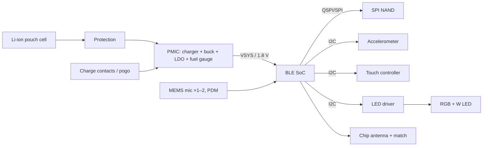

# Architecture patterns

These are common shapes for small connected products, and the part families that usually fill each function.

> **Everything here is an example to verify, not a current fact.** Part families, packages, lifecycle and prices change. Before a part enters `hw/bom.csv`, `electronics-researcher` checks it against the manufacturer's page and datasheet. Families are named so you know where to start looking.

## Product shapes

### A. BLE wearable recorder or sensor (pendant, clip, badge)

- **Dominant constraints:** cell volume against average current, and the stack-up height.
- **Typical averages:** a tuned BLE SoC streaming compressed audio draws about 1–3 mA. Shipping products have measured about 5–15 mA. Assume the high end until a dev kit says otherwise.
- **Storage:** SPI NAND of 1–8 Gbit for hours of offline audio. Size it from bitrate × hours, plus 2× for bad blocks and wear. NOR flash is enough for minutes, not hours.

### B. BLE tracker or tag (item finder)

SoC, coin or small pouch cell, buzzer or speaker, button, LED, optional accelerometer.

- **Network specs** (Find My-type networks, Google's finder network, the IETF DULT draft) set requirements on sound and anti-stalking. One example is a sound of at least 60 phon at 25 cm. Read the current specification before you choose the sound part.
- Coin cells cannot supply high pulse currents. Check the pulse capability and the internal resistance at low temperature.

### C. Wi-Fi sensor or appliance controller

Wi-Fi SoC (ESP32-C/S-class or similar), a buck converter from USB or mains, sensors on I2C or SPI.

- Wi-Fi TX peaks are about 250–400 mA. Use a buck converter rated for the peak, plus bulk capacitance.
- Small wearable PMICs, with discharge limits around 100–125 mA, and tiny cells cannot feed Wi-Fi. On battery, Wi-Fi forces a bigger cell, a different power path, or BLE only.
- Pre-certified modules trade area for certification cost and RF risk.

### D. USB device (dongle, keyboard, MIDI, instrument)

MCU with USB FS/HS, ESD on D+/D−, a 5 V input with protection, and usually no battery.

- USB-IF logo use, the compliance test and the VID/PID cost are planning items.
- The connector's mechanical strength (through-hole legs, shell tabs) matters more than its electrical choice.

### E. Cellular tracker

LTE-M/NB-IoT module, GNSS, SIM or eSIM, a large cell, and an antenna for each band.

- Peak current of about 0.5–2 A during TX. Module certification and carrier approval are separate projects.
- The antenna volume is usually what decides the product's size. Start the antenna design early.

## Function → part families

| Function | Families to start from | Selection traps |
|---|---|---|
| BLE SoC | Nordic nRF54L / nRF52 / nRF53; Silicon Labs EFR32BG; TI CC23xx/CC26xx; Espressif ESP32-C/H (BLE + Wi-Fi) | Smallest package often in sampling last; GPIO differ by package; CSP pitch versus fab limits |
| Wi-Fi SoC | Espressif ESP32-S/C; Infineon CYW; Nordic nRF70 companion | TX peaks; antenna keep-out; module versus chip-down certification |
| PMIC / charger | Nordic nPM13xx; TI BQ2xxxx chargers and BQ25xxx; ADI MAX7765x/MAX20xxx | Discharge-current limit; charge current range for tiny cells; ship-mode current; fuel-gauge accuracy |
| Battery protection | TI BQ297xx; ABLIC S-82xx | Often already inside custom cells; do not double-protect without reason |
| Storage | Winbond W25N (SPI NAND), GigaDevice GD5F, Micron MT29F SPI, Kioxia; W25Q / MX25 NOR | Voltage variant (1.8 V vs 3 V) forces a rail; NAND needs ECC and bad-block handling; large NAND can dominate silicon cost |
| MEMS mic | TDK InvenSense T58xx/ICS; Infineon IM69/IM73; Knowles SPH; ST MP23/MP34 | Bottom-port vs top-port decides board hole and gasket; acoustic activity detect modes; SNR vs current |
| Accelerometer / IMU | ST LIS2DH12/LIS2DW12/LSM6; Bosch BMA4xx/BMI2xx; ADI ADXL36x | Wake-on-motion current; FIFO depth; package height |
| Touch | Azoteq IQS (single-channel to trackpad); Microchip CAP1xxx; SoC-integrated capacitive sense | Trackpad controllers for one button are overkill; check lifecycle labels; electrode design through plastic |
| LED (RGB / W) | ams OSRAM, Lite-On, Würth, Inolux, Kingbright | Max height vs nominal; color-temperature bins; CRI is per bin; integrated RGBW whites are often cool and uncontrolled |
| LED driver | TI LP58xx; ISSI IS31FL; SoC PWM + MOSFETs | Minimum VCC (often ≥ 2.5 V); I2C address per variant; DSBGA pitch on flex |
| Speaker / buzzer | Micro-speakers (PUI, CUI, Knowles); piezo transducers; MEMS speakers (xMEMS-type) | Loudness spec of finder networks; acoustic volume and port; drive voltage |
| Haptics | ERM/LRA (Vybronics, Jinlong) + TI DRV26xx driver | Current pulses; mounting stiffness |
| Antenna | Chip antennas (Johanson, Kyocera AVX, Ignion); PCB inverted-F | Ground-clearance keep-out; matching network; detuning by body and enclosure |
| Crystal | 32 MHz / 32.768 kHz (ECS, Epson, NDK, Murata, TXC) | Footprint sizes nearly identical; load capacitance and tolerance per SoC spec; obsolete small sizes |
| Charge contacts | Spring contacts (Harwin EZi-type, Würth); pogo pins (Mill-Max, Preci-Dip); molded insert contacts | Working gap and stroke; plating thickness for wear and sweat; magnet alignment |
| Board-to-board / flex | Hirose BM/DF; Molex SlimStack; JAE; ZIF/FPC connectors; or hot-bar soldered flex | Mated height per suffix; retention in drop; simplified 3D models hide interference |
| Acoustic / vent membranes | W. L. Gore, SAATI, Nitto, Donaldson | Direct sales only for some; PFAS restrictions; acoustic loss vs IP rating |
| ESD | Nexperia, TI TPD, Littelfuse, Semtech | Every external contact and button; capacitance on data lines |

## Architecture comparison: worked shape

| | A1: single BLE SoC | A2: SoC + Wi-Fi companion |
|---|---|---|
| Silicon area | ~25 mm² | ~55 mm² |
| Peak current | ~10 mA | ~350 mA (needs another PMIC and cell) |
| Average current | 1–3 mA (estimate, ×2 margin) | 3–8 mA |
| Silicon cost at 1k | lower | +USD 3–5 |
| Risk | NAND sync over BLE throughput | power path, certification, size |
| **Recommendation** | **chosen: meets the size and autonomy requirements** | rejected: violates the cell volume |

Values in this table illustrate the format. Compute your own from dossiers and tag them per CONVENTIONS §6.
